# autofly_ue5: project status, 2026-10-07 (updated 2026-10-08)

What this project has built and measured so far, in one folder: the simulation side of AutoFly (arXiv 2602.09657)
recreated on Unreal Engine 5.7.4 + Project AirSim 1.0.1, SAC "expert" pilots that fly procedurally built obstacle
scenes, and the AutoFly-format dataset their flights become. Every number below is read from a record: sections 1–3
from the copies in `records/` (of `docs/gates/*.json` and the dataset's own files) by `scripts/results_figures.py`,
sections 4–8 from the `docs/gates/` and `runs/` files each one names, by the figure script it names; the videos are the
project's own renders (`scripts/render_episodes.py`, `scripts/dataset_episode_video.py`). Code state: `main` at
3827c00.

## Milestones

| # | Milestone | State | Evidence |
|---|---|---|---|
| M0 | UE5 + Project AirSim installed, smoke test | **Passed** 2026-09-15 | `m0_gate.json` |
| M1 | `sim/` module; scene s01 built from JSON and packaged | **Passed** 2026-09-16 | `m1_gate.json` |
| M2 | SAC expert on s01 (white pillars) ≥ 0.95 over 200 episodes | **Passed** 2026-09-26: 0.98 deterministic, 0.99 stochastic | `records/m2_gate.json` |
| M2d | moving pillars (s01d): expert ≥ 0.95 | **Gate failed, expert accepted** (2026-10-07): 0.775 → 0.885 → 0.920 → **0.935** over six runs against the bar of 0.95; the user accepted the 0.935 expert for collection, stochastically, and no run 7 starts (`docs/decisions/2026-10-07-s01d-accepted-at-0.935.md`) | `records/m2d_*_gate.json` |
| M3 | collector, dataset writer, validator; 100-episode pilot | **Passed** 2026-10-03: 100 of 101 episodes kept, 17,738 records, TFDS reads them back exactly | `records/m3_gate.json` |
| M4 | asset library; scenes s02–s12 | **In progress**: eight scenes built, packaged and gated live (s01, s02, s03, s04, s05, s06, s07, s09); the footprint contact rule for mesh scenes (2026-10-08); the 60-entry target pool live in the simulator, 35 of them drawable (C5/C6); per-scene exposure, with s05's snow at −12 EV (C7). Left: s08 (no asset yet), s10–s12 (Fab), s05r, s06r | `docs/gates/m4_*_gate.json`, `m4_targets_probe.json`, `docs/superpowers/plans/…plan5…` |
| M5 | an expert per scene, then collection | **Started** 2026-10-08: s02 run 1 trained (12.0 h, 640,916 steps, no backend fault); its pre-registered evaluation is running | `docs/gates/m5_s02_train.json`, `docs/decisions/2026-10-08-m5-s02-r1-evaluation-plan.md` |
| M5 (part) | dataset rebalancing (paper App. A.2.4) | **Done on the pilot** 2026-10-07 | `records/s01_pilot_rebalance.json` |
| M6 (part) | path efficiency (the paper's PER) | **Measured on the pilot** | `records/s01_pilot_path_efficiency.json` |

## 1. The experts and their gates

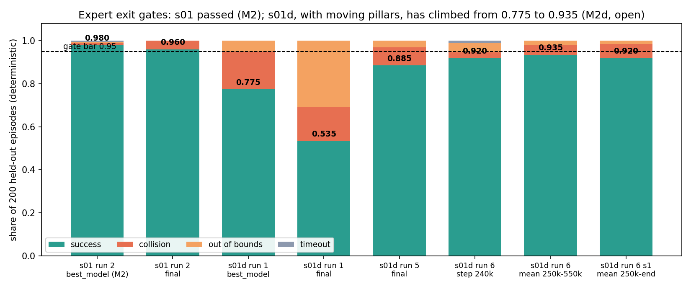

Each bar is one trained expert flown deterministically on the same 200 held-out episodes (seeds the training never
saw). s01's expert passed at 0.98. On s01d, where 8–12 of the 80 pillars move along random routes and yield to the
drone, six runs took the success rate from 0.775 to 0.935; the remaining failures are near misses at full speed past
a mover that has stopped to yield (`docs/decisions/2026-10-06-s01d-r6-plan.md`). What moved the number, run by run:

| Run | Change | Gate |
|---|---|---|
| 1 | depth-only expert, 3 stacked depth frames | 0.775 (best_model); final learned to dive out of the altitude band (0.535) |
| 2 | warm start from run 1 with a fresh buffer | collapsed within 15k updates (never warm-start SAC without its buffer) |
| 3 | from scratch, privileged mover input, out-of-bounds priced like a collision | 0.65 on 20 episodes at 200k; paused |
| 4 | run 3 + per-step mover clearance penalty | 0.78 in selection; did not move the contact distances |
| 5 | run 4 + a 0.3 m training contact margin and an altitude margin | **0.885**; mover collisions 35 → 7 |
| 6 | run 5 + a 1.1 m static boundary, a 0.5 m mover margin, a V-shaped altitude cost | **0.920**; static collisions 10 → 0; the **mean of 31 checkpoints 0.935** |
| 6, session 1 | 500k more steps; the 250k–end mean | 0.920, and 186/200 on a fresh confirmation set (0.925 over both) |

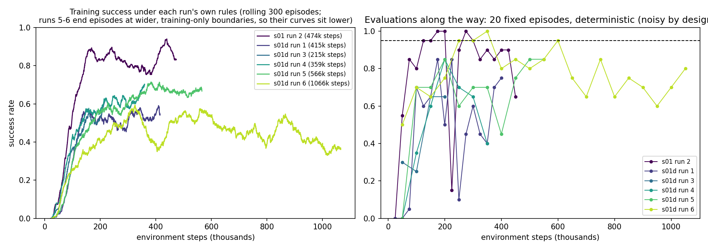

Left: training success under each run's own rules (runs 5–6 end episodes at wider training-only boundaries, which is
why they sit lower while gating higher). Right: the 20-episode deterministic evaluations made along the way, noisy by
design; checkpoints are chosen on 40- and 100-episode validation stages, never on these.

Videos (`videos/`): `s01_m2_best_model_ep027_success.mp4` (a clean crossing of the pillar field),
`s01_m2_best_model_ep175_collision.mp4` (one of its four collisions), `s01d_run1_best_model_ep037_collision.mp4`
(run 1 hit by a mover from out of view), `s01d_run6_mean_ep000_success.mp4` (the current best expert weaving past
movers), `s01d_run6_mean_ep091_mover_collision.mp4` (the failure that remains: a near miss past a yielding mover),
`s01d_run6_mean_ep012_out_of_bounds.mp4`. Each video shows the front camera's RGB, the depth the policy flies on, and
the top-down path; `maps/` holds the overview maps of every rendered episode set.

## 2. The dataset (M3) and its rebalancing

The collector flies the s01 expert stochastically from a start aligned to the target's 45° sector (AutoFly's a0) and
keeps only successful, collision-free episodes. The pilot: 100 kept of 101 flown, 17,738 records, each holding exactly
AutoFly's four fields (front RGB 256×256, the instruction, action[3], state[9]), written to a raw store and exported
as RLDS/TFDS shards that TensorFlow Datasets reads back exactly. Median speed 1.97 m/s against the released
episodes' 1.87–1.96; median episode 172 records (the released: 96 and 78).

Videos: `videos/dataset_s01_400000000.mp4`, `dataset_s01_400000009.mp4`, `dataset_s01_400000026.mp4` play three
recorded episodes back with the instruction, the state and the action each record holds, plus Grounding DINO's
confidence for the target and the phase the rebalancing assigns.

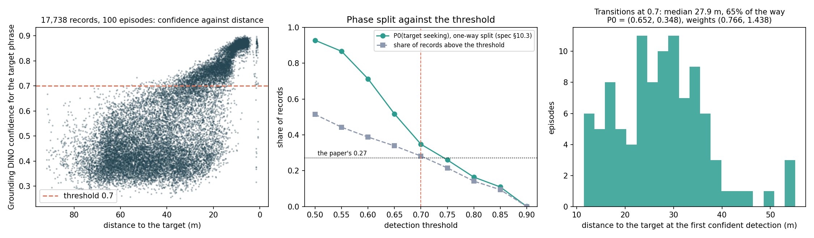

AutoFly rebalances its trajectories by phase: obstacle avoidance until Grounding DINO first detects the target with
confidence above 0.7, target seeking from then on, then resamples towards a uniform mix (its measured split 0.73/0.27,
weights 0.68/1.85). On the pilot:

| | pilot | paper |
|---|---|---|
| phase split P0 (avoidance, seeking) at 0.7 | **0.652 / 0.348** | 0.73 / 0.27 |
| resampling weights for a uniform target | **0.766 / 1.438** | 0.68 / 1.85 |
| share of records with a confident detection (the paper's per-record wording) | 0.281 | 0.27 |
| first detections on the target | 99 of 100 (2 of 4,993 confident records sit on something else) | — |
| transition | median 27.9 m from the target, 65 % of the way through the episode | — |

The split is less skewed than the paper's because the placeholder target (a 2 m orange cylinder, alone in its colour
against a grid floor) is visible from far out; the per-record reading reproduces the paper's number. Nothing was tuned
to match; the threshold is a one-line rerun on the cached scores (`docs/decisions/2026-10-06-dataset-rebalancing.md`).

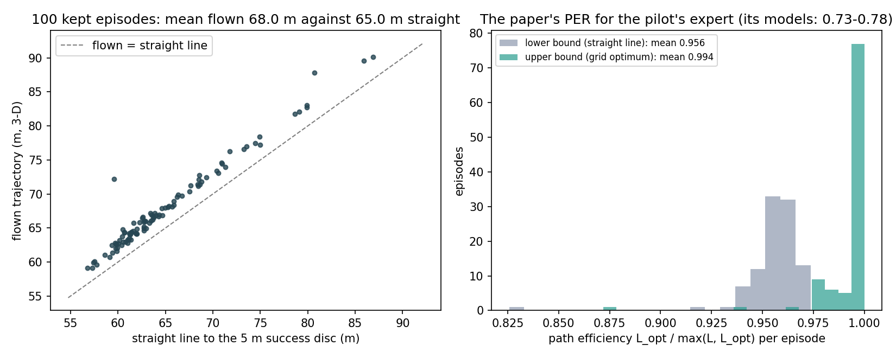

The paper's path-efficiency metric (PER = L_opt / max(L, L_opt)) for the pilot's expert lies between **0.956** (the
straight line as L_opt, a lower bound) and **0.994** (the shortest grid path, an upper bound). The paper's models score
0.73–0.78 on its scenes. s01 is an easy scene by this metric; the expert flies it almost straight.

## 3. Towards the other scenes (M4)

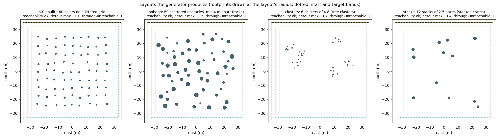

The scene generator now places every type the design names: s01's jittered grid, scattered obstacles (`poisson`, for
rocks and ruins), `clusters` (tree clusters), and `stacks` (boxes on top of each other), several groups per scene
without overlap, and a detour metric answers whether a layout can be crossed *through* its obstacle field rather than
around it (s01: 1.01, every start crosses through). Two of the paper's scenes (stacked boxes, coloured poles) need no
downloaded assets and will be built first; the rest need CC0 trees, rocks and grounds (Poly Haven, ambientCG) and, for
vehicles and buildings, Fab assets under their licence. The plan with its decisions is
`docs/superpowers/plans/2026-10-06-autofly-ue5-plan5-scenes-and-assets.md`.

## 4. The first new scenes, seen through the drone's cameras (M4, 2026-10-07)

`scenes/`: for s01 and the three scenes built today -- s09 coloured poles on cobbles, s07 stacked boxes on sand, s02
sparse young trees (Poly Haven, CC0) on grass -- the RGB and depth frames from each edge's start and from close-ups of
three obstacles (`scripts/scene_snapshots.py`), with per-pose brightness and depth-at-surface numbers in the JSON. The
poles' depth lands 2 mm from the geometry; boxes and trees are farther than their footprint circles say, never closer.

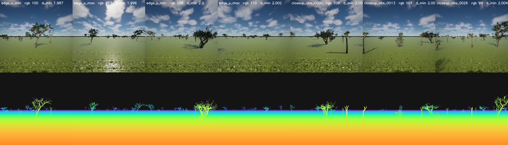

The live checks that gated s01 (M1) now run on any scene: s09 and s07 passed (`docs/gates/m4_s09_gate.json`,
`m4_s07_gate.json`: every actor within microns, depth within millimetres, crashes where predicted). s02 failed its
crash check: a crash into a canopy wedges the simulator's actor among the leaf cards, which the next step removes from
the collision mesh (`docs/decisions/2026-10-07-m4-live-checks-and-foliage.md`). The same checks caught that the trees'
leaves were invisible to the depth camera and fixed it. With the leaf cards split into a no-collision companion mesh
the s02 gate passed on its third record (`m4_s02_gate_run3.json`); wood still wedged 2 of 4 crashed bodies, which is
what the next section answers.

## 5. The footprint contact rule for mesh scenes (2026-10-08)

In a scene whose obstacles are imported models (trees now, rocks next), the task's contact rule is no longer physical
contact, because a body that reaches wood can wedge the simulator's actor for good. An episode ends as a collision when
the drone's swept step passes within 0.9 m of an obstacle's footprint circle (the layout's `radius_m`, the model's
whole horizontal reach at its scale), checked by the environment on every step exactly as s01d's 1 m mover rule is; the
simulator's collision event stays as a backstop. The gate scores this rule and records it (`contact_rules`), the
collector rejects by it, and a training run may widen it by at most 0.2 m
(`docs/decisions/2026-10-08-footprint-contact-rule.md`, `autofly_ue5/expert/footprint_contact.py`).

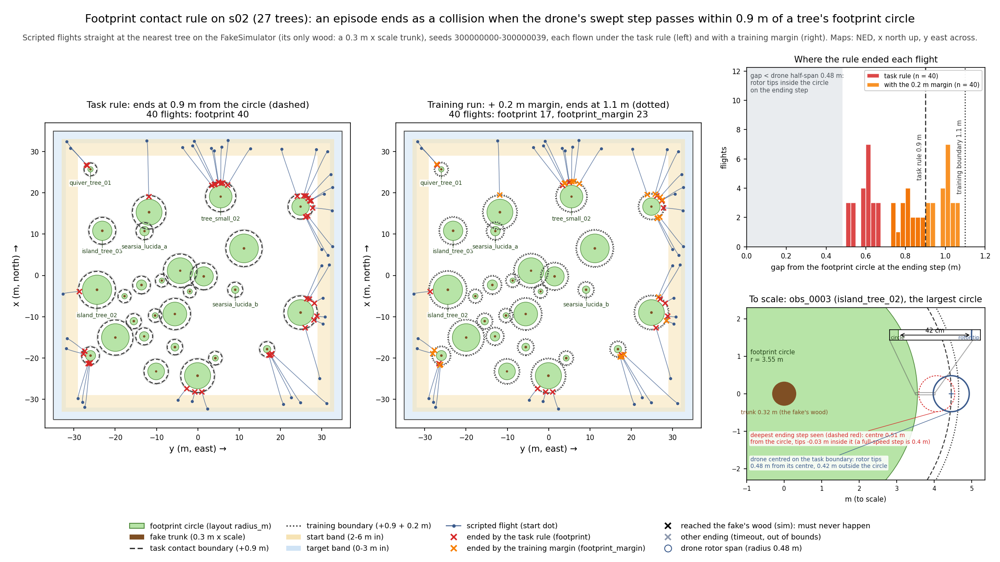

Forty scripted flights straight at s02's trees on the fake simulator, each flown under the task rule (left) and with
the 0.2 m training margin (right): every flight ends between 0.51 and 0.88 m from its circle under the rule, so no rotor
tip (0.48 m from the centre) ever enters a circle, including on the ending step, which overshoots by up to a full-speed
step of 0.4 m. The first version of the rule, at 0.5 m, failed exactly that test: all 40 ending steps had a rotor tip
inside the circle (gaps 0.11–0.48 m), which this figure caught and the offline tests had not. The close-up draws the
largest tree to scale with the drone sitting on the boundary. Numbers: `figures/s02_footprint_rule.json`
(`scripts/footprint_rule_figure.py`).

## 6. Four more scenes: scattered rocks, tree clusters, a stone field, standing stones (C4, 2026-10-08)

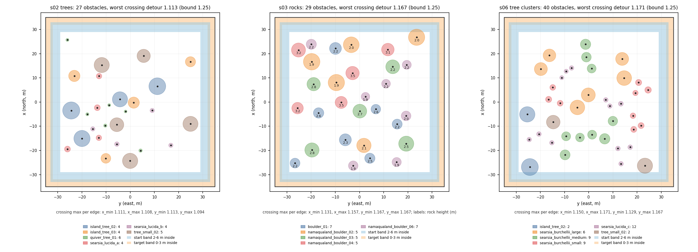

s03 scatters 29 Poly Haven boulders over grass, each scaled 1.5–3.4× so that it reaches into the 1–3 m flight band
(at natural size most of them would pass under the drone); s06 places 36 searsia bushes in single-species clusters
with four taller trees standing above them. Both are accepted by the layout rule (worst crossing detour 1.167 and
1.171 against the 1.25 bound; the first drafts were denser and failed it), and both passed the live gate
(`docs/gates/m4_s03_gate.json`, `m4_s06_gate.json`: every actor within microns, depth probes on a boulder and on the
two tree species, crashes where predicted). The crash into a boulder left the simulator's actor wedged, as wood does,
which is exactly what the footprint rule of section 5 keeps the experts from doing
(`docs/decisions/2026-10-08-c4-s03-s06.md`).

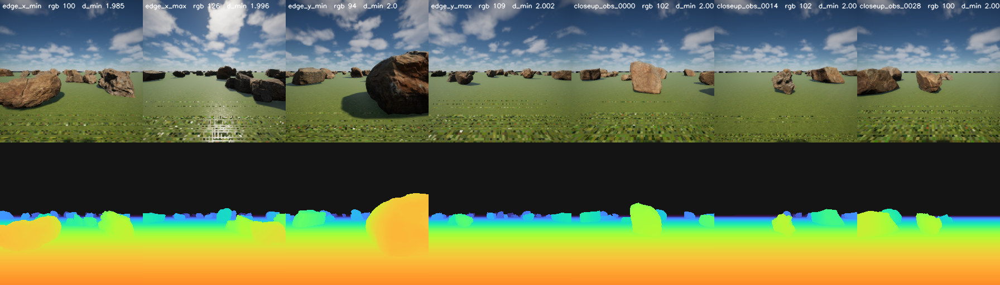

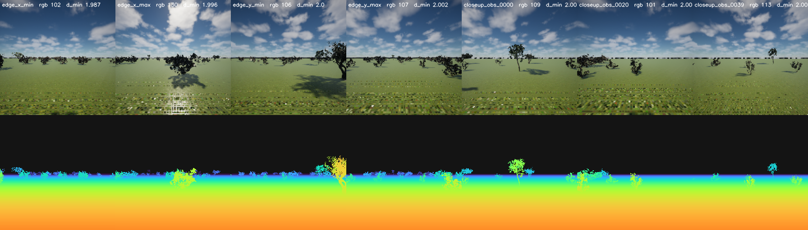

In the afternoon two more rock scenes followed. s04, a stone field on gravel, has 33 stones 1.4–2.2 m tall: 11 natural
boulders and 22 painted in the red/blue/yellow/green/white palette the poles use (worst crossing detour 1.157). s05,
standing stones on snow, has 12 boulders stretched into standing stones 4–6.7 m tall beside 12 ordinary boulders
(detour 1.142). Both passed the live gate (`docs/gates/m4_s04_gate.json`, `m4_s05_gate.json`: 33 and 24 actors as
built within 4 µm, depth probes on a boulder at 3, 6 and 12 m, the crash into it at 7.80 m of travel against 7.56 m
predicted on s04 and 7.26 m against 7.22 m on s05, both resets freed by a 1.5 m retrace on the first attempt).

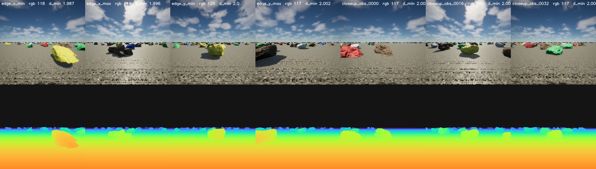

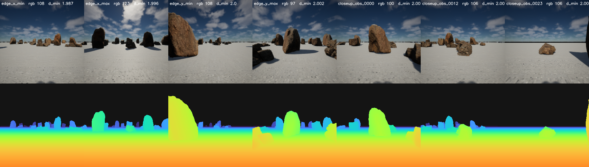

Snow needed its own exposure (C7). Its texture reflects 3.95× what grass does, so a scene file may now set
`exposure_bias_ev`, and s05 sets −12 EV, estimated from that albedo and confirmed on the first build: its seven
snapshot poses average 97–123 of 255 with no saturated pixel (`scenes/s05_snapshots.json`), around s01's calibrated
109. s04's gravel needs no change (117–144 at −11 EV).

## 7. s02's first expert and what its failures showed (M5, 2026-10-08)

The first expert on a mesh scene trained on s02 (sparse young trees) from scratch for 12 hours, on one depth frame, four
simulators, the footprint rule of section 5 with its 0.2 m training margin (`docs/gates/m5_s02_train.json`):

| s02 run 1 | |
|---|---|
| steps | 640,916 in 12.0 h: 14.8 steps/s at N = 4 (14.9 measured beforehand, `docs/gates/m5_s02_instances.json`) |
| training episodes | 4,812: 1,583 successes, 2,530 collisions, 625 out of bounds, 74 timeouts (under the training rules) |
| collisions by source | 2,482 at the training margin (1.1 m), 19 at the task's 0.9 m rule, 29 the simulator's own contact event |
| faults | 0 backend faults, 0 relaunches, no GPU error |

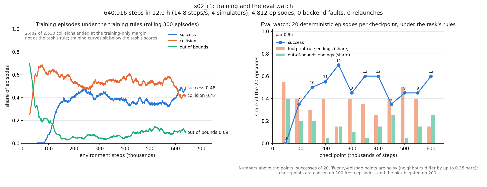

Left: training episodes, rolling over 300. Success stayed at zero until about 85k steps, reached 0.4 by 200k and then
hovered at 0.32–0.49, ending at 0.48; nearly every collision ended at the training-only margin. Right: the eval watch,
20 deterministic episodes per 50k checkpoint under the task's rules: 0.00 at 50k, a high of 0.70 at 250k, 0.60 at 600k,
far under the 0.95 bar. Of its 240 flights 112 succeeded; the footprint rule ended 85 and the altitude band or the
scene's edge 40. Twenty-episode points are noisy (neighbours differ by up to 0.35 here), so no checkpoint is chosen on
them (`figures/s02_r1_training.json`, `scripts/m5_training_figure.py`).

Since the footprint rule was the commonest failure, its 82 endings in the first 220 watched flights were measured
against the trees' real geometry, ray-cast from the glTF models exactly as the live checks do
(`scripts/footprint_endings_figure.py`):

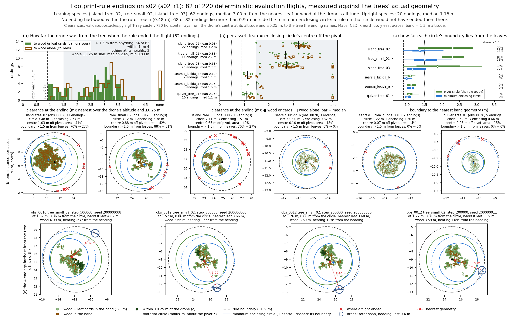

When the rule ended a flight the drone was a **median 2.70 m** from the nearest leaf or wood at its altitude, never
closer than 0.94 m. Over the whole flight band only **9 of 82** endings came within 0.9 m of the tree's real outline,
which is the distance the rule means to keep. The cause is the circle: it is centred on the model's pivot with the
model's whole reach as its radius, and three of s02's six species lean (canopies 0.65–1.03 m off the pivot). They took
62 of the 82 endings at a median 3.00 m from any leaf, against 1.18 m for the 20 on upright species: on the side away
from the lean the circle bulges up to about 3 m past the leaves. The nearest leaf or wood was in the camera's view in
only 8 endings. The expert flies on depth alone, so it was stopped by a boundary it cannot see, and a wider training
margin would only push that boundary farther out. The minimum enclosing circle would shrink the leaning trees' circles
by 41–49 % in area, and the outline itself is tighter still (`figures/s02_footprint_endings.json`).

So the rule is to measure to the trees' real outline rather than to the pivot circle: **decided** 2026-10-08, being
built and reviewed, not yet applied to any run. Run 1's evaluation goes on as pre-registered before any result existed
(`docs/decisions/2026-10-08-m5-s02-r1-evaluation-plan.md`): three named candidates (the checkpoint means over
200k–end and 350k–end, and `final`) fly the same 100 fresh episodes under the circle rule, the best is gated once on
200, and a failed gate stays failed. If run 2 trains under the outline rule, run 1's pick is also flown under it on
the same 200 episodes as a separate record, so the two runs are compared under one rule.

## 8. The target pool, live (C5/C6, 2026-10-08)

Collection draws each episode's target and its distractors from a pool, and the instruction names the target. The pool
has 60 entries (`assets/targets.json`): 48 imported models (23 Poly Haven, CC0; 25 Kenney stand-ins: 12 vehicles,
10 people, 2 animals and a traffic cone) and 12 engine primitives (cylinders, cubes, cones and spheres in five
colours). The pool now draws **35** of them, the 23 Poly Haven models and the 12 primitives; the 25 Kenney stand-ins
are imported and spawn correctly but stay undrawn until the user decides whether their blocky style may stand in for
the paper's vehicles and people.

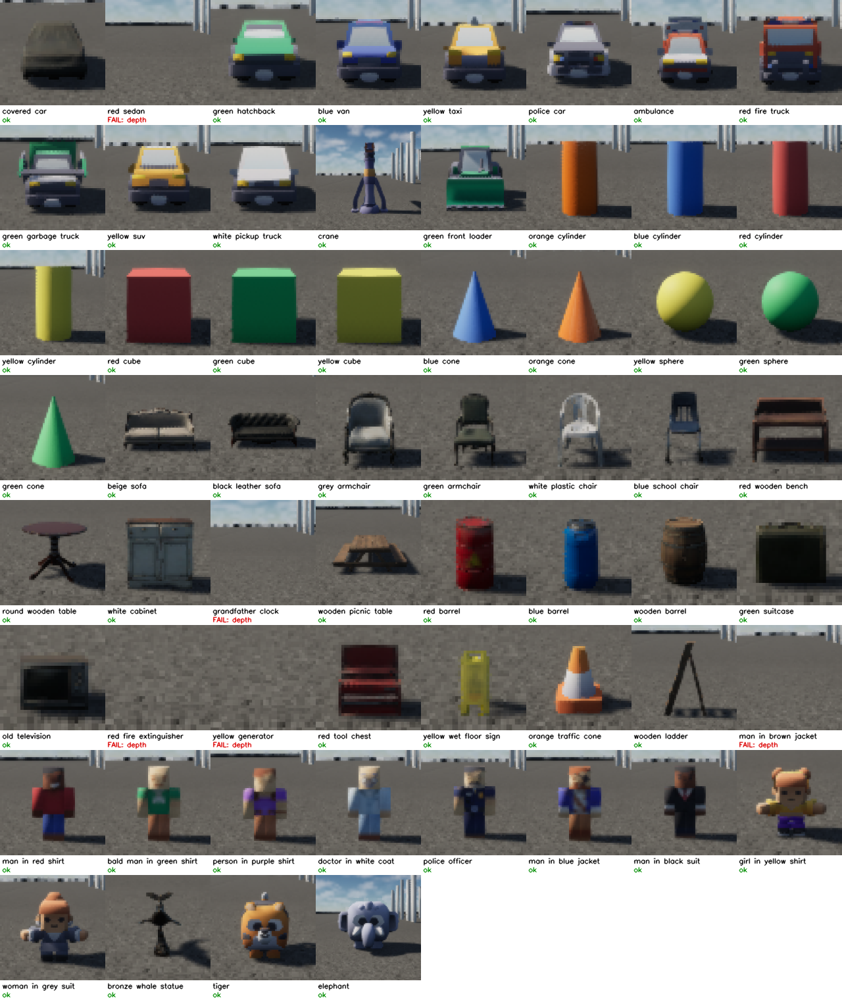

The live probe (`docs/gates/m4_targets_probe.json`, sheet from `runs/m4/targets_probe/`) spawned each of the 60 entries
on s01 in front of the drone: every one is in the spawn table, spawns, and has its registry size to the millimetre;
55 of 60 show in the depth frame one step after spawning. The five blank tiles (the red sedan, the grandfather clock,
the fire extinguisher, the generator and the man in the brown jacket) are not broken assets but first-use loading:
a diagnostic spawned them again in a fresh session and each was visible within five steps (1 s), and on a second
spawn at once; the three Poly Haven models were absent one step after their first spawn there too
(`runs/m4/targets_settle_diag/settle.json`). So before the first collection with the pool, every pool
asset is to be shown once in view after each launch, so that no recorded first frame misses its target. The probe's
record says "failed" for those five, as written; nothing was re-run to make it pass.

## 9. A new direction, and a pilot for every scene (plan 6, 2026-10-08)

The lab mentor asked for diversity of objects and scenes and a working prototype that a VLA can be attached to, over
expert quality or scene count. Plan 6 (`docs/superpowers/plans/2026-10-08-autofly-ue5-plan6-prototype-dataset.md`)
therefore trains no new experts: each scene is flown by the best existing expert whose kept-rate is at least 0.25,
and only successful, collision-free episodes are kept.

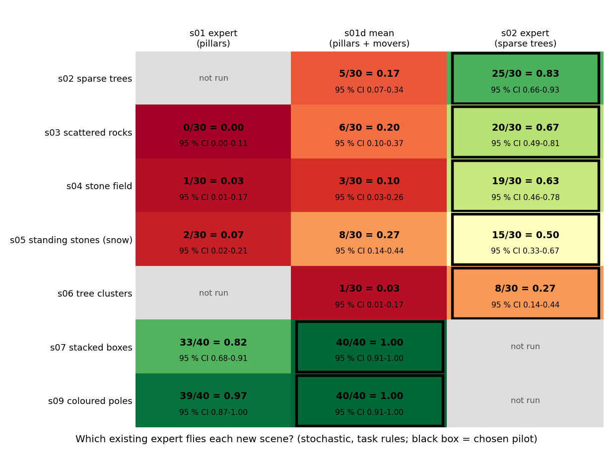

The screening (`docs/gates/m5_pilot_screening.json`) flew 30-40 stochastic episodes per pair under the task's rules.
- **Box and pole scenes:** the accepted s01d mean flies s07 and s09 without a failure, 40 of 40 each.
- **Rock and tree scenes:** the pillar experts fail (0.00-0.27); they learned to pass surfaces closely, which the mesh
  scenes' 1.05 m outline rule ends. The s02 tree expert, trained under the more conservative circle, is the best on
  every one: s02 0.83, s03 0.67, s04 0.63, s05 0.50, s06 0.27.
- s06 tree clusters sits at the plan's 0.25 bar, so its collection costs about four flights per kept episode.

Videos: `videos/screening/` holds two or three replays per scene, named by scene, pilot, episode and outcome. They
are stochastic replays, so an outcome can differ from the screening's (s04 episode 0 crashed in screening and
succeeds here).

## 10. The thin slice: every scene collected under real conditions (plan 6, 2026-10-08 evening)

Nine stores of 50 kept episodes each, one per training scene, flown by each scene's pilot with the full 60-target pool,
per-scene look-alike exclusions, a0-aligned starts and the task's contact rules: 450 kept of 676 flights
(`docs/gates/plan6_pilots.json`). Every pilot clears plan 6's bar (the kept-rate's 95 % lower bound at least 0.25);
s06 tree clusters is the hardest at 0.39.

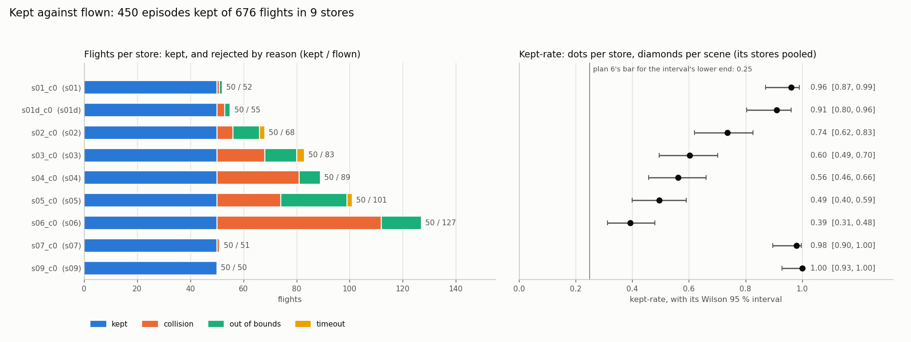

The objects the drone flies to, as it reaches them (the last frame of one episode per target):

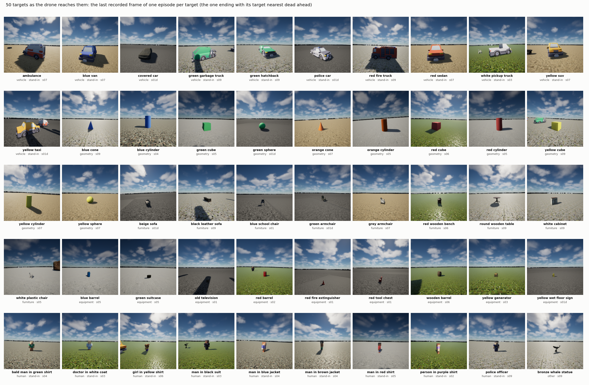

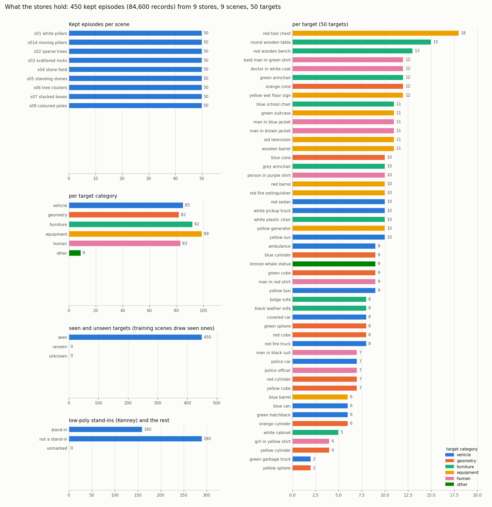

Kept flights cross the obstacle field (84-94 % enter its core); collisions cluster among the trees:

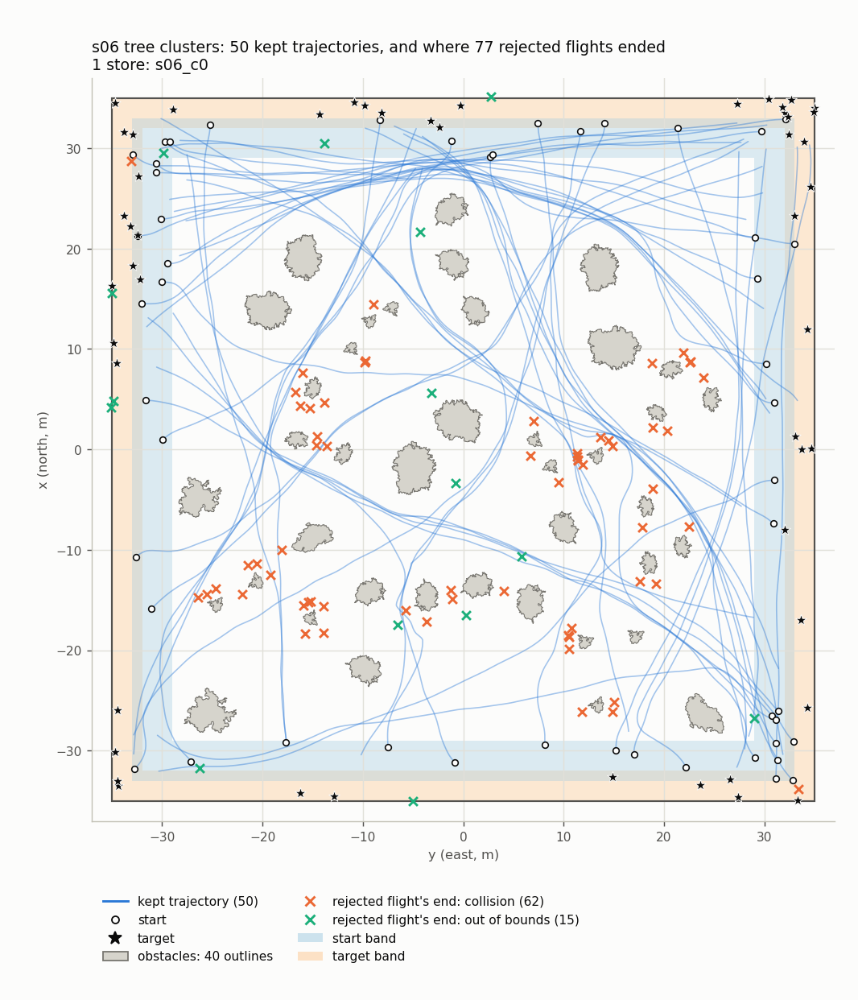

- **A rendering lag was found and fixed.** Under the load of eight simulators, an object spawned at an episode's
  start was not drawn in the next frame, and a first use could take 20+ steps. Each simulator session now warms
  every target once, verified visible, and every episode holds 5 steps after its spawns
  (`docs/decisions/2026-10-08-reset-hold-and-warmup.md`).
- **So the thin slice measures, and the final dataset is collected afresh**: four more 50-kept stores per scene,
  1,800 episodes, started 22:02 on seven simulators.
- **The pipeline works on real pool data**: the three finished stores merged into one TFDS dataset that TFDS read
  back exactly and an OpenVLA-style loader iterated; the evaluation harness flew seen, test_seen and unseen-target
  episodes live.

## Numbers worth knowing

- Simulation runs at 1 ms real-time update rate in lock-step at 5 Hz; four simulators plus an evaluator share one
  RTX 4090 at 13.5 environment steps/s in total; a 12 h training run is 550k–560k steps on s01d. On s02 four
  simulators made 14.9 steps/s (one: 11.3), and 12 h made 640,916 steps.
- A built scene whose assets are imported costs under half an hour of live time (build, package, snapshots, gate);
  only packaging needs every simulator stopped.
- One 100-episode dataset is 1.77 GB of PNG frames, stored twice (raw store and RLDS shards). The paper's 13K episodes
  would need about 460 GB.
- Grounding DINO (tiny) scores 0.34 frames/s on the host's CPU; the pilot took 14.5 h beside live training without
  slowing it.

## Where things are

- Design: `docs/superpowers/specs/2026-09-15-autofly-ue5-dataset-design.md`. Plans: `docs/superpowers/plans/`.
- Every gate and probe: `docs/gates/`. Every decision and incident: `docs/decisions/`.
- Procedures: `docs/runbook-m2.md`, `runbook-m2d.md`, `runbook-m3.md`, `runbook-rebalance.md`.
- The dataset: `data/s01_pilot/` (raw store, `1.0.0/` RLDS shards, `detections.json`, `rebalance.json`).
- Training runs and renders: `runs/expert/`, `runs/viz/`.
